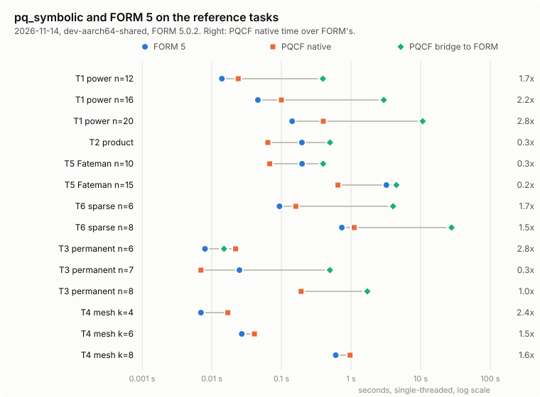

# pq_symbolic and FORM: the standing comparison

PQCF's symbolic engine (`pq_symbolic`) is compared with FORM (J.A.M. Vermaseren et al.; version 5,
arXiv:2601.19982) on fixed reference tasks. The comparison runs every week until the end of the project, and the
results stay in the repository:

- [`RESULTS.md`](RESULTS.md) holds the latest run.
- [`history.csv`](history.csv) holds every run, one row per task, so trends and regressions show.
- [`charts/`](charts) holds three SVG charts, redrawn by every run:
  - the latest run;
  - the algorithm change of 2 November 2026;
  - the native-to-FORM ratio run by run.

The decision record behind it is [`docs/decisions/SY-FORM-comparison.md`](../../docs/decisions/SY-FORM-comparison.md).

## The tasks

| Task | What it measures |
| --- | --- |
| T1, power | expanding (1 + x1 + … + x6)^n, n = 12, 16, 20: raw polynomial throughput (FORM's ground) |
| T2, product | squaring (1 + x + y + z + w)^10: a dense product |
| T3, permanent | the permanent of an n × n matrix of symbols, n = 6, 7, 8: boson sampling's building block |
| T4, mesh | the symbolic unitary of a k-mode Clements mesh with every angle a symbol, k = 4, 6, 8: the engine's own workload |
| T7, gcd | 10 multivariate polynomial gcds each, as in T. Ueda's polybench (its defaults: 5 variables, factors of 22–30 terms of degree 22–30, coefficients up to 2¹⁴): gcd(a·g, b·g) (nontrivial) and gcd(a·b, c·d) (coprime); added with decision record SY2 |

Each task runs three ways:

- **native:** `pq_symbolic`.
- **bridge:** `pq_form`, PQCF's optional FORM backend. FORM runs as an external program and its result is read back
  into PQCF's canonical form. The bridge covers the polynomial fragment only, so it does not run on T4.
- **FORM:** FORM alone, on the equivalent script.

A run fails if the native and bridge results differ in any way, or if the term counts of the three disagree.

## Running it

- **Every Saturday, 04:30:** a cron job on the development machine (dev-aarch64-shared, core 8) runs `run.sh`; the
  results are committed by hand after a look. `.github/workflows/form-comparison.yml` is meant to do the same every
  Monday on GitHub's x86_64 runner, but it has not committed a run yet (every row of `history.csv` is from the
  development machine). It can also be started by hand, from the Actions tab.
- **As a check:** on every push that touches the symbolic engine, the bridge or this directory, the same workflow
  runs without committing.
- **On another machine:** `COMPARISON_MACHINE=<label> CPUSET=<core> sh comparison/form/run.sh`.

The FORM image is `comparison/form/Dockerfile`: the dev image plus FORM and FLINT 3.2.2, built from their sources.
FORM is GPL-3 and PQCF Apache-2.0, so FORM runs only as a separate program. It is never linked into PQCF or shipped
with it.
