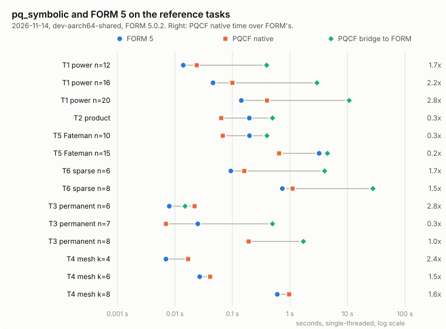
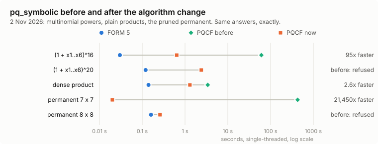
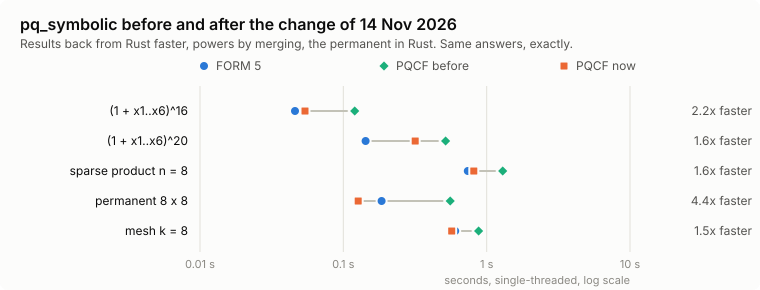
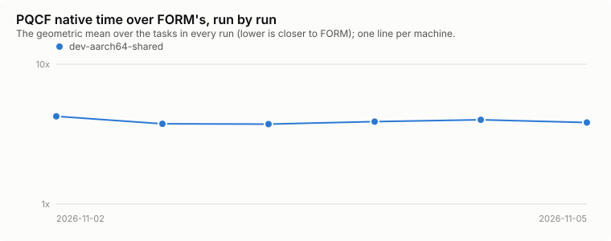

# pq_symbolic and FORM: the standing comparison

Generated by `comparison/form/compare.erl`. Do not edit by hand: the weekly workflow
(`.github/workflows/form-comparison.yml`) and `comparison/form/run.sh` rewrite this file and append to
`history.csv`. The decision record is `docs/decisions/SY-FORM-comparison.md`.

Latest run: 2026-11-14T06:18:03Z on dev-aarch64-shared (Cortex-A725+Cortex-X925, aarch64-unknown-linux-gnu), PQCF 43d6f57, FORM 5.0.2 (Sep 16 2026, v5.0.2-2-gfb12f2e).

All times are seconds, single-threaded. The columns are:

- **FORM:** FORM alone on the equivalent script, best of three runs.
- **native:** `pq_symbolic`.
- **ratio:** native divided by FORM.
- **bridge:** `pq_form`, FORM run as an external process with the result read back into PQCF's
  canonical form. A dash means the task is outside the bridge's polynomial fragment.
- **check:** `ok` means native and bridge are exactly equal and all term counts agree.

| Task | What | Terms | FORM | native | ratio | bridge | check |
| --- | --- | --- | --- | --- | --- | --- | --- |
| T1 power n=12 | (1 + x1 + ... + x6)^12 expanded | 18564 | 0.014 | 0.024 | 1.7 | 0.394 | ok |
| T1 power n=16 | (1 + x1 + ... + x6)^16 expanded | 74613 | 0.046 | 0.100 | 2.2 | 2.957 | ok |
| T1 power n=20 | (1 + x1 + ... + x6)^20 expanded | 230230 | 0.143 | 0.400 | 2.8 | 10.710 | ok |
| T2 product | ((1 + x + y + z + w)^10)^2: a dense product | 10626 | 0.197 | 0.064 | 0.3 | 0.499 | ok |
| T5 Fateman n=10 | f (f + 1), f = (1 + x + y + z + t)^10 (Fateman) | 10626 | 0.198 | 0.068 | 0.3 | 0.398 | ok |
| T5 Fateman n=15 | f (f + 1), f = (1 + x + y + z + t)^15 (Fateman) | 46376 | 3.223 | 0.649 | 0.2 | 4.487 | ok |
| T6 sparse n=6 | f g, f = (1 + x + y + 2z^2 + 3t^3 + 5u^5)^6, g its mirror (Monagan and Pearce) | 114000 | 0.094 | 0.161 | 1.7 | 4.022 | ok |
| T6 sparse n=8 | f g, f = (1 + x + y + 2z^2 + 3t^3 + 5u^5)^8, g its mirror (Monagan and Pearce) | 591235 | 0.738 | 1.112 | 1.5 | 27.774 | ok |
| T3 permanent n=6 | permanent of a 6 x 6 matrix of symbols | 720 | 0.008 | 0.022 | 2.9 | 0.015 | ok |
| T3 permanent n=7 | permanent of a 7 x 7 matrix of symbols | 5040 | 0.025 | 0.007 | 0.3 | 0.498 | ok |
| T3 permanent n=8 | permanent of a 8 x 8 matrix of symbols | 40320 | 0.185 | 0.192 | 1.0 | 1.717 | ok |
| T4 mesh k=4 | symbolic unitary of a 4-mode Clements mesh, every angle a symbol | 400 | 0.007 | 0.017 | 2.5 | - | ok |
| T4 mesh k=6 | symbolic unitary of a 6-mode Clements mesh, every angle a symbol | 11616 | 0.027 | 0.041 | 1.5 | - | ok |
| T4 mesh k=8 | symbolic unitary of a 8-mode Clements mesh, every angle a symbol | 276800 | 0.603 | 0.969 | 1.6 | - | ok |
